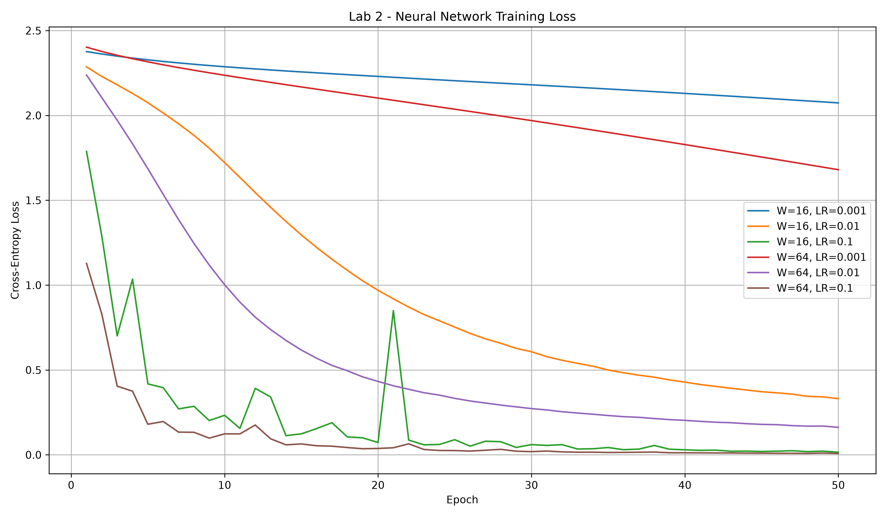
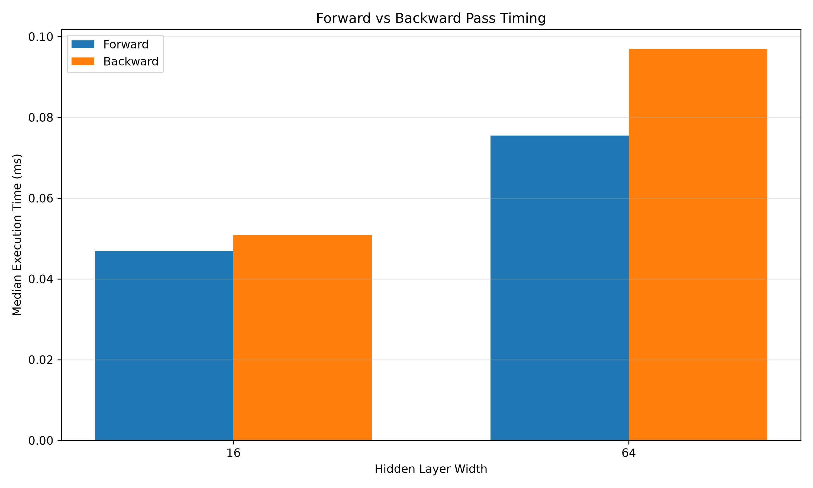

# Lab 2: Neural Network From Scratch

## Objective

Implement and evaluate a fully connected neural network using NumPy, including forward propagation, cross-entropy loss, backpropagation, numerical gradient checking, mini-batch training, and execution-time benchmarking.

## Task 1: Dataset Preparation

- Dataset: scikit-learn Digits
- Samples: 1,797
- Input features: 64
- Output classes: 10
- Input normalization: divide pixel values by 16
- Labels: one-hot encoded
- Split: 70% training / 30% testing
- Random state: 42
- Training samples: 1,257
- Testing samples: 540

## Task 2: Network Architecture

Two hidden layers were implemented.

Architecture:

Input (64) -> Hidden (W) -> ReLU -> Hidden (W) -> ReLU -> Output (10) -> Softmax

Tested widths: W = 16 and W = 64.

Parameter dimensions:

- W1: (64, W), b1: (W,)
- W2: (W, W), b2: (W,)
- W3: (W, 10), b3: (10,)

Normal initialization N(0, 0.01) was used for the architecture and initial-loss checks. He initialization was used for the training experiments to support ReLU learning.

## Task 3: Forward Propagation

Forward propagation was implemented using matrix multiplication, ReLU activation, and softmax.

Validation confirmed output shape (batch_size, 10) and probability row sums within 1e-6 of 1.

Result: PASSED.

## Task 4: Cross-Entropy Loss

Cross-entropy loss was implemented from scratch.

The initial network loss was approximately ln(10) = 2.3026.

Result: PASSED.

## Task 5: Backpropagation and Gradient Checking

Analytical gradients were derived using the chain rule and implemented using NumPy.

Numerical gradient checking used perturbations of +/- 1e-5.

- Checks passed: 10/10
- Required relative error: less than 1e-6
- Result: PASSED

## Task 6: Training Experiments

Settings:

- Epochs: 50
- Mini-batch size: 32
- Learning rates: 0.001, 0.01, 0.1
- Hidden widths: 16, 64
- Training method: mini-batch gradient descent

### Accuracy Results

| Width | Learning Rate | Train Accuracy | Test Accuracy |
|---|---|---|---|
| 16 | 0.001 | 25.22% | 24.07% |
| 16 | 0.01 | 91.25% | 89.81% |
| 16 | 0.1 | 99.92% | 97.22% |
| 64 | 0.001 | 68.50% | 65.74% |
| 64 | 0.01 | 96.66% | 94.26% |
| 64 | 0.1 | 100.00% | 97.78% |

The best configuration was W=64 with learning rate 0.1, achieving 97.78% test accuracy.

The lowest learning rate resulted in slower convergence over the fixed 50-epoch budget.

### Loss Curves

## Task 7: Execution-Time Benchmarking

Forward and backward passes were timed separately using the median of 100 repetitions.

| Width | Forward (ms) | Backward (ms) | Total (ms) |
|---|---|---|---|
| 16 | 0.0468 | 0.0508 | 0.0976 |
| 64 | 0.0755 | 0.0969 | 0.1724 |

The backward pass was slower for both network widths.

Backpropagation involves additional matrix multiplications to calculate parameter gradients and propagate gradients through earlier layers.

Increasing hidden-layer width also increases matrix multiplication cost.

### Timing Chart

## Conclusion

All seven lab tasks were executed successfully.

The experiment demonstrates how network width and learning rate influence training convergence and classification accuracy.

The highest recorded test accuracy was 97.78%, using two hidden layers of width 64 and a learning rate of 0.1.

Numerical gradient checking passed all ten checks, supporting the correctness of the implemented backpropagation.

## Reproduction

Run from the repository root:

    python lab02/src/lab2.py

## Project Structure

    lab02/
    |-- src/
    |   |-- lab2.py
    |-- results/
    |   |-- loss_curves.png
    |   |-- task6_accuracy_results.csv
    |   |-- task7_benchmark_results.csv
    |   |-- task7_execution_time.png
    |-- report.md
