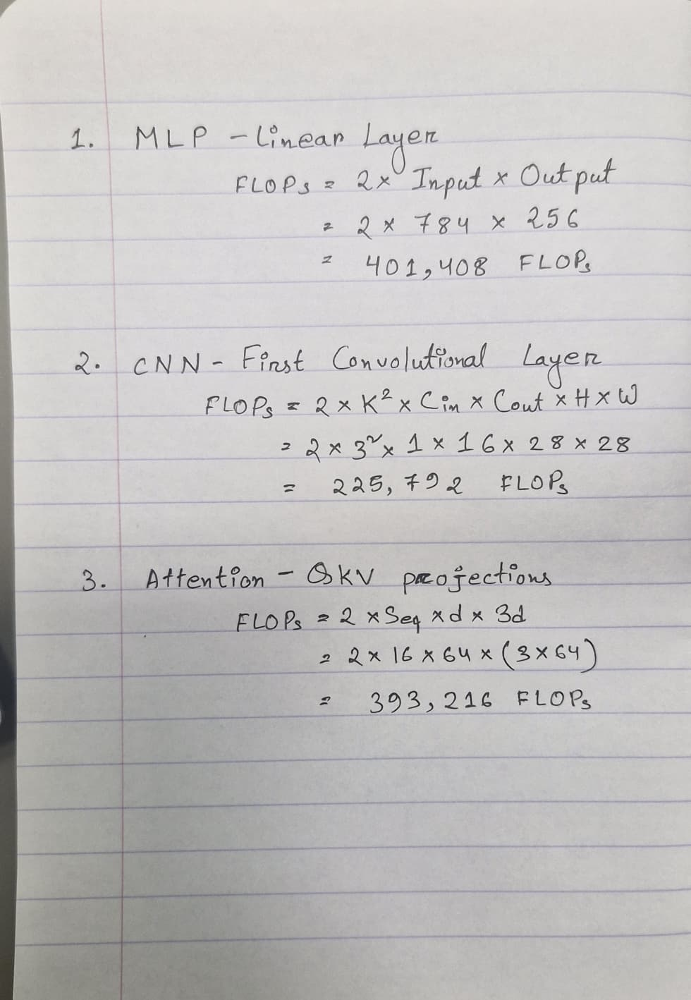
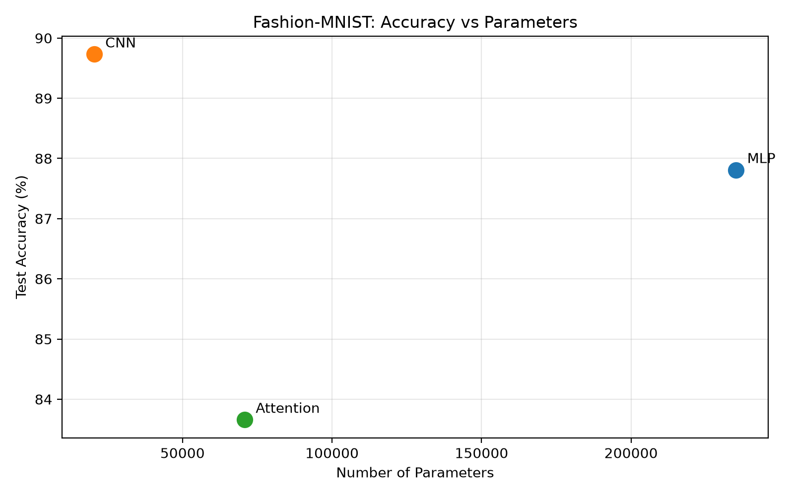
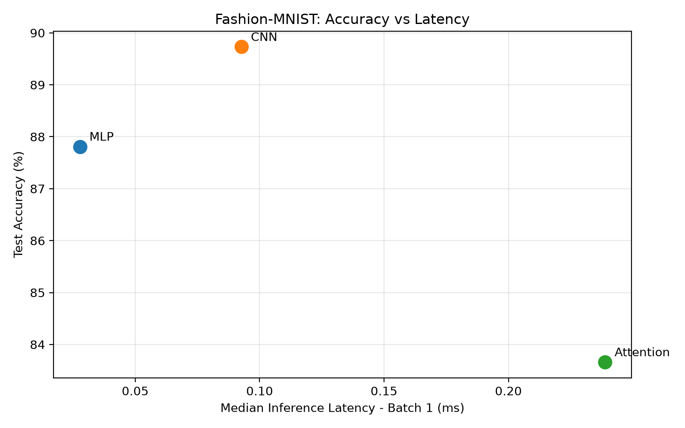

# Lab 3 — Architectures and Their Costs

## 1. Objective

Compare MLP, CNN and Attention architectures on Fashion-MNIST in terms of classification accuracy, parameter count, computational cost and inference latency.

## 2. Dataset and Training

- Dataset: Fashion-MNIST
- Training images: 55,000
- Validation images: 5,000
- Testing images: 10,000
- Normalization: Mean = 0.2860, Std = 0.3530
- Batch size: 128
- Epochs: 5
- Optimizer: Adam
- Learning rate: 0.001
- Device: CPU

## 3. Architectures

**MLP:** Flatten → Linear(784,256) → ReLU → Linear(256,128) → ReLU → Linear(128,10).

**CNN:** Conv2d(1,16,3) → ReLU → MaxPool2d(2) → Conv2d(16,32,3) → ReLU → MaxPool2d(2) → Flatten → Linear(1568,10).

**Attention:** Sixteen 7×7 patches → Linear(49,64) → Two Transformer encoder layers (4 heads, feedforward dimension 128) → Mean pooling → Linear(64,10).

The specified architectures produce different parameter counts despite the manual's suggested target of 100k–150k parameters.

## 4. Experimental Results

| Model | Parameters | Test Accuracy | THOP MACs | Estimated FLOPs |
|---|---:|---:|---:|---:|
| MLP | 235,146 | 87.81% | 234,752 | 469,504 |
| CNN | 20,490 | 89.73% | 1,031,744 | 2,063,488 |
| Attention | 70,794 | 83.66% | 591,488 | 1,182,976 |

### Inference Latency

| Model | Batch 1 (ms) | Batch 128 (ms) |
|---|---:|---:|
| MLP | 0.028 | 0.191 |
| CNN | 0.093 | 5.421 |
| Attention | 0.239 | 1.624 |

The reported latency values are medians of 100 runs for batch 1 and 20 runs for batch 128, with five warm-up iterations.

## 5. Hand-Calculated FLOPs

The following calculations represent individual layers and use the convention of approximately two FLOPs per multiply-accumulate operation.

### MLP — First Linear Layer

FLOPs = 2 × 784 × 256 = **401,408**

### CNN — First Convolutional Layer

FLOPs = 2 × 3² × 1 × 16 × 28 × 28 = **225,792**

### Attention — QKV Projections

FLOPs = 2 × 16 × 64 × (3 × 64) = **393,216**

These values represent selected layers rather than full-model computation.

The THOP results estimate model-level operations using supported profiling hooks. They cannot be directly compared to individual-layer calculations as though both measured the same scope. THOP may also omit operations such as attention matrix multiplication, normalization, activations and other functional operations, depending on its supported hooks.



## 6. Accuracy and Cost Comparison

### Accuracy vs Parameters



### Accuracy vs Inference Latency



## 7. Architectural Trade-offs

**MLP:** Dense matrix operations offer relatively low latency for small inputs. However, fully connected layers require many weights and do not explicitly exploit spatial locality in images.

**CNN:** Convolutional layers reuse filters across image locations and exploit spatial locality. This reduces parameter count, although convolution generates substantial arithmetic and feature-map memory traffic. The CNN achieved the highest test accuracy with the fewest parameters.

**Attention:** Self-attention can model relationships between image patches. QKV projections, attention matrices and multiple encoder operations introduce computational and memory-access overhead. Attention score storage scales quadratically with sequence length. On this small image-classification task, the Attention model achieved lower accuracy and higher single-image inference latency than the other architectures.

## 8. Conclusion

The CNN was the most cost-effective architecture when prioritizing accuracy and parameter efficiency, achieving **89.73% test accuracy with only 20,490 parameters**.

The MLP achieved the lowest measured inference latency, making it attractive when single-image response time is the primary concern.

The Attention model was less competitive under this training configuration.

Overall, architecture selection depends on the relative importance of accuracy, parameter storage, computation, memory-access patterns and latency.

## 9. Reproduction

Install dependencies from the repository's `requirements.txt`, then run the following commands from the `lab03` directory:

```bash
python models.py
python dataset.py
python -u train.py
python -u profile_models.py
python plots.py
```

The experiments generate trained model checkpoints, JSON results and comparison plots in the `results` folder.
