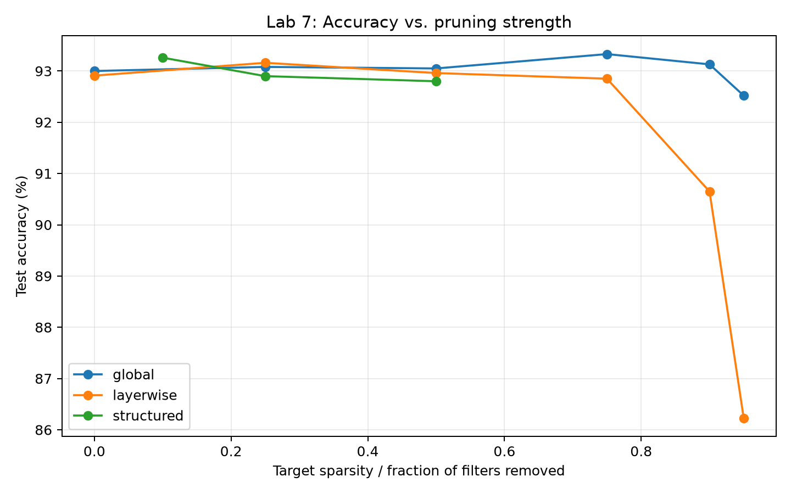
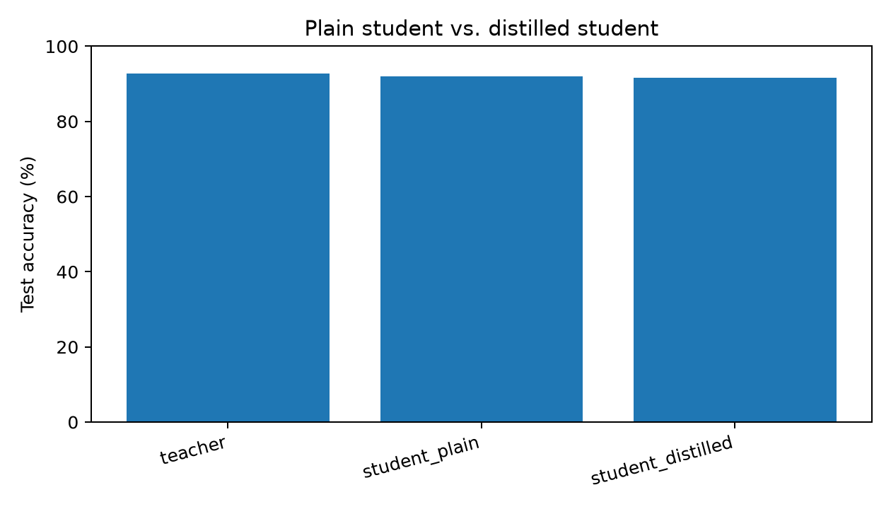
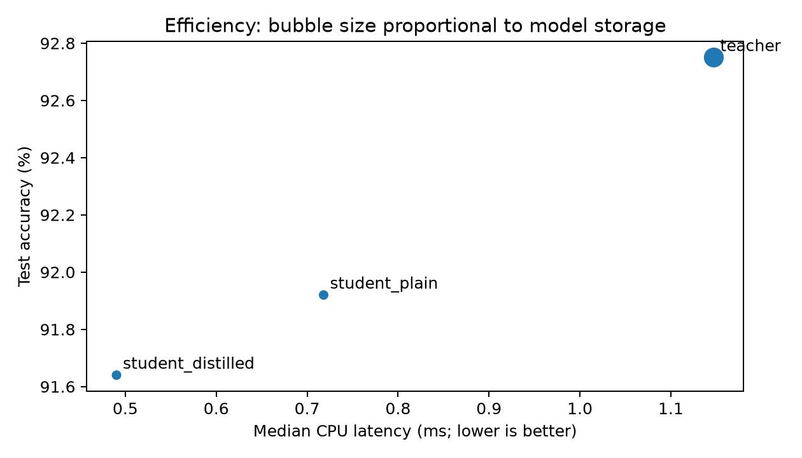

# Machine Learning Lab 7 — Compression: Pruning and Distillation

**Student:** Imam Hossain  **ID:** 73947  
**Course:** Machine Learning (CII5SE039CI)

## Methodology and experimental setup

- Dataset: Fashion-MNIST, 54,000 training / 6,000 validation / 10,000 test samples.
- Seed: 73947; batch size: 128; initial training device: cpu.
- Teacher epochs: 8; student epochs: 8; mask-fixed fine-tune epochs: 3.
- All reported accuracies are on the official held-out Fashion-MNIST test set.
- CPU latency is single-image batch=1 with 20 warmups, measured for the configured number of iterations.
- Latency preprocessing represents tensor resize (32→28) and normalization, not file decoding or camera capture.
- FLOPs are approximated as 2 × multiply-accumulate operations (MACs), omitting activations and pooling.
- Energy: not measured (no power meter). CPU time and MACs are only proxies, not joules.
- Unstructured sparse NPZ stores nonzero weight coordinates and values only, omitting biases and layer metadata; it is **not a deployable checkpoint**.

## Results — all experiments

| Model | Test acc. % | Parameters | Sparsity | Checkpoint MB | Sparse weights NPZ MB | Median ms | p95 ms | MACs |
|---|---:|---:|---:|---:|---:|---:|---:|---:|
| teacher | 92.75 | 1,097,962 | 0.00% | 4.395 | 5.597 | 1.15 | 1.60 | 30,132,288 |
| global_0 | 93.00 | 1,097,962 | 0.00% | 4.395 | 5.597 | 0.94 | 1.62 | 30,132,288 |
| global_0p25 | 93.08 | 1,097,962 | 25.00% | 4.395 | 4.171 | 3.36 | 3.95 | 30,132,288 |
| global_0p5 | 93.05 | 1,097,962 | 50.00% | 4.395 | 2.770 | 3.56 | 4.10 | 30,132,288 |
| global_0p75 | 93.33 | 1,097,962 | 75.00% | 4.395 | 1.374 | 3.47 | 4.01 | 30,132,288 |
| global_0p9 | 93.13 | 1,097,962 | 90.00% | 4.395 | 0.551 | 4.77 | 15.55 | 30,132,288 |
| global_0p95 | 92.52 | 1,097,962 | 95.00% | 4.395 | 0.280 | 3.54 | 4.94 | 30,132,288 |
| layerwise_0 | 92.91 | 1,097,962 | 0.00% | 4.395 | 5.597 | 3.38 | 4.57 | 30,132,288 |
| layerwise_0p25 | 93.16 | 1,097,962 | 25.00% | 4.395 | 4.164 | 3.38 | 3.75 | 30,132,288 |
| layerwise_0p5 | 92.96 | 1,097,962 | 50.00% | 4.395 | 2.766 | 3.93 | 4.32 | 30,132,288 |
| layerwise_0p75 | 92.85 | 1,097,962 | 75.00% | 4.395 | 1.379 | 3.79 | 4.19 | 30,132,288 |
| layerwise_0p9 | 90.65 | 1,097,962 | 90.00% | 4.395 | 0.557 | 1.29 | 1.89 | 30,132,288 |
| layerwise_0p95 | 86.23 | 1,097,962 | 95.00% | 4.395 | 0.282 | 0.92 | 1.17 | 30,132,288 |
| structured_0p1 | 93.26 | 979,001 | 0.00% | 3.920 | 4.990 | 1.63 | 2.33 | 24,741,896 |
| structured_0p25 | 92.90 | 806,634 | 0.00% | 3.230 | 4.113 | 2.53 | 2.86 | 17,180,608 |
| structured_0p5 | 92.80 | 526,826 | 0.00% | 2.111 | 2.689 | 1.10 | 1.97 | 7,841,600 |
| student_plain | 91.92 | 94,298 | 0.00% | 0.381 | 0.481 | 0.72 | 1.13 | 6,510,656 |
| student_distilled | 91.64 | 94,298 | 0.00% | 0.381 | 0.481 | 0.49 | 0.55 | 6,510,656 |

## Efficiency pillars (Chapter 9)

| Pillar | Evidence and interpretation |
|---|---|
| Data | Same Fashion-MNIST train/validation/test splits for all experiments. No change in training data volume across models. |
| Model | Compare parameter count, checkpoint size, nonzero weight sparsity and sparse representation. Sparse representation is not a runnable model file. |
| Compute | Compare MACs and actual measured CPU latency. Masking unstructured weights does not change the dense computation graph. |
| Energy | No joules measured: cannot claim energy savings. Reduced MACs and latency may suggest lower energy, but power draw is unknown. |

## Task 3 — Honest latency and storage interpretation

Global and layer-wise magnitude masks retain original dense tensor shapes. Standard PyTorch dense convolutions and matrix multiplies still process all the zeros; latency is not expected to scale with sparsity. A sparse weight-only file can shrink storage at high sparsity but needs metadata and a sparse execution backend to run. Structured filter removal rebuilds smaller dense layers, reducing parameters and MACs; that may yield genuine hardware speedups, subject to CPU kernel efficiency.

## Task 4 — Distillation

- Temperature T=4, alpha=0.5.
- Loss: alpha × cross-entropy with true labels + (1−alpha) × T² × KL(teacher probabilities || student probabilities).
- A plain student uses the same small architecture and training length, without teacher logits.

## Conclusion

Teacher reached 92.75% accuracy at 1.15 ms median CPU latency. Plain student reached 91.92%; distilled student reached 91.64% (change -0.28 percentage points).
Read the pruning table for the accuracy cost of increasing sparsity; do not assume that sparsity itself reduces dense-kernel latency.

## Limitations and reproducibility

- CPU benchmark numbers depend on processor, competing processes, and backend; repeat on the submission machine.
- Each pruning run is initialized from the same teacher baseline; fine-tuning does not change target masks.
- The teacher and student are selected by validation accuracy and evaluated on the test set.
- Logs and checkpoints are saved under results/ and checkpoints/.
- Task 2 pruning targets are applied to eligible convolutional and linear weights; biases are not masked.
- For structured pruning, the stated fraction is the fraction of output filters removed from each convolution (rounded per layer).
- Test set is evaluated for each configured experiment for educational reporting; no test-driven hyperparameter selection should be performed.
