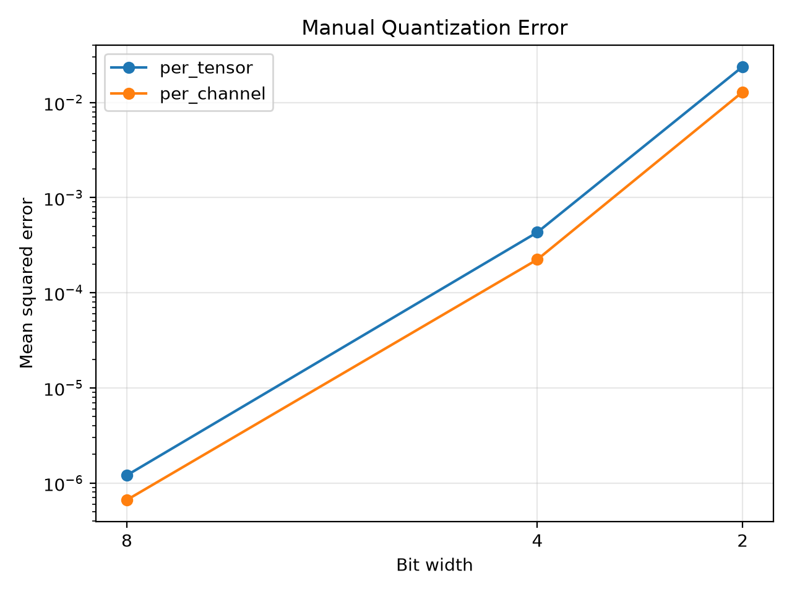
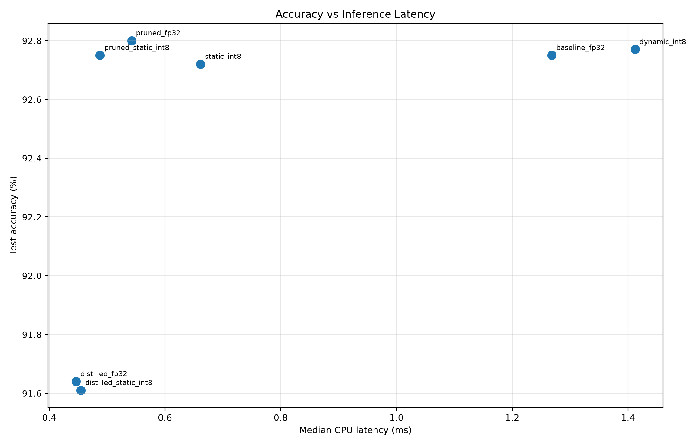
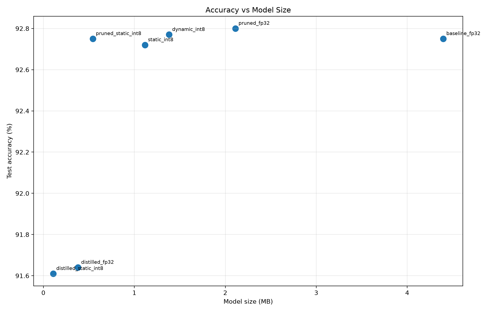

# Lab 8 - Quantization and Export

Student: Imam Hossain
Student ID: 73947

## Task 1 - Manual quantization

Symmetric quantization was performed on the first convolutional
weight tensor of the Lab 7 teacher model using zero-point 0.

| Precision | Per-tensor MSE | Per-channel MSE |
|---|---:|---:|
| INT8 | 0.0000012046 | 0.0000006632 |
| INT4 | 0.0004322211 | 0.0002236546 |
| INT2 | 0.0238202475 | 0.0129069798 |

Per-channel scaling reduced reconstruction error at every precision.
Lower bit widths produced higher quantization error.
INT4 and INT2 were simulated using restricted integer ranges,
not native packed deployment formats.

## Task 2 - Dynamic quantization

Dynamic INT8 quantization was applied to the linear layers.
Convolutional layers remained FP32.

| Model | Accuracy | Size MB | Median latency ms |
|---|---:|---:|---:|
| Baseline FP32 | 92.75 | 4.396 | 1.278 |
| Dynamic INT8 | 92.77 | 1.382 | 1.497 |

Model size decreased by 68.56%.
Accuracy increased by 0.02 percentage points.
Dynamic quantization did not improve latency in this benchmark.

Backend: oneDNN.
FBGEMM was unavailable in the installed PyTorch build.

## Task 3 - Static quantization

Static INT8 quantization was performed using FX graph-mode
quantization with 500 randomly selected training images.

All three convolutional layers and both linear layers were quantized.

Test accuracy: 92.72%
Model size: 1.116 MB
Median latency: 0.653 ms
P95 latency: 1.096 ms

Calibration data must represent real inputs because observers
estimate activation ranges. Unrepresentative calibration can
cause clipping, excessive rounding error and accuracy degradation.

## Task 4 - ONNX export

The FP32 teacher was exported using ONNX opset 17.

| Metric | Result |
|---|---:|
| Test images | 10000 |
| Maximum absolute error | 9.536743e-06 |
| Required tolerance | 1e-4 |
| MSE | 1.142423e-12 |
| Prediction agreement | 100% |
| Test accuracy | 92.75% |
| ONNX median latency | 2.513 ms |
| PyTorch median latency | 5.044 ms |
| Speedup | 2.01x |

Numerical validation passed.

Latency speedup refers to the paired ONNX benchmark and should
not be generalized to separate benchmark runs.

## Task 5 - Combined model optimization

All seven variants were evaluated using the same single-threaded
CPU benchmark protocol.

| Model | Accuracy % | Size MB | Median latency ms |
|---|---:|---:|---:|
| Baseline FP32 | 92.75 | 4.396 | 1.268 |
| Pruned FP32 | 92.80 | 2.111 | 0.542 |
| Distilled FP32 | 91.64 | 0.381 | 0.446 |
| Dynamic INT8 | 92.77 | 1.382 | 1.412 |
| Static INT8 | 92.72 | 1.116 | 0.661 |
| Pruned + INT8 | 92.75 | 0.543 | 0.488 |
| Distilled + INT8 | 91.61 | 0.108 | 0.455 |

### Deployment recommendations

| Platform | Recommended candidate | Reason |
|---|---|---|
| Cloud | Pruned FP32 | Highest observed accuracy |
| Edge | Pruned + INT8 | Maintains baseline accuracy with smaller size and lower latency |
| Mobile | Distilled + INT8 | Compact model with competitive accuracy |
| TinyML | Distilled + INT8 | Smallest candidate, subject to runtime and RAM constraints |

Pruned + INT8 provides a strong overall trade-off, reducing
model size by approximately 87.65% while maintaining baseline
accuracy and achieving approximately 2.60x inference speedup.

Mobile, cloud and microcontroller performance were not directly
measured. Deployment recommendations require target-device testing.

## Task 6 - Individual project milestone

Project: Real-Time Traffic Sign Recognition for Driver-Assistance
on a CPU-Only Edge Device.

Dataset: GTSRB
Architecture: Pretrained ResNet-18
Input resolution: 48 x 48 RGB
Classes: 43
Training images: 22530
Validation images: 4110
Test images: 12630
Training epochs: 10

The pipeline groups validation images by physical sign track.
Weighted cross-entropy addresses class imbalance.
Training uses checkpointing, validation-based model selection
and MLflow experiment tracking.

| Metric | Result |
|---|---:|
| Parameters | 11198571 |
| Best validation accuracy | 96.79% |
| Test accuracy | 95.94% |
| Macro-F1 | 0.9475 |
| Model size | 44.87 MB |
| Median CPU latency | 14.83 ms |
| P95 CPU latency | 15.97 ms |

Latency includes resizing and normalization but excludes disk I/O.
The project benchmark used four CPU threads.

The baseline meets the latency target but does not yet meet
the final accuracy, macro-F1 and compressed model size targets.
Robustness and safety-related confusion analysis remain future
project milestones.

The baseline checkpoint and metrics.json are included.

## Limitations

- oneDNN was used instead of FBGEMM due to backend availability.
- PyTorch legacy quantization APIs produced deprecation warnings
  but executed successfully.
- CPU timings depend on processor load and backend efficiency.
- Serialized model size is not equivalent to peak runtime memory.
- TinyML compatibility and energy consumption were not measured.
- Project dataset counts reflect the installed torchvision dataset.
- Quantized Fashion-MNIST models are generated locally from Lab 7
  checkpoints and are excluded from Git.

## Conclusion

Static quantization and structured pruning significantly reduced
model size and CPU inference latency without substantial accuracy
loss. ONNX export preserved numerical agreement within the
required tolerance. The individual project now has a trained
ResNet-18 baseline for future compression experiments.

## Lab 4 pipeline continuity

The original Lab 4 pipeline is tracked at lab04/src/pipeline.py
and uses the Adult Income dataset.

The individual GTSRB project requires an image-specific pipeline.
The adapted project pipeline is provided at project/pipeline.py
with grouped validation splitting, image preprocessing and
class imbalance handling.
